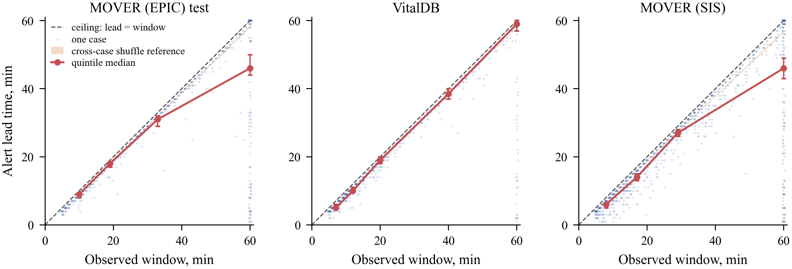
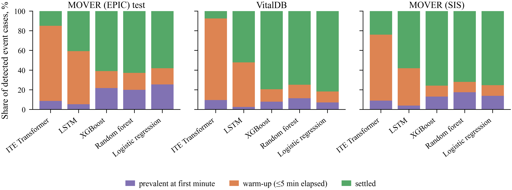
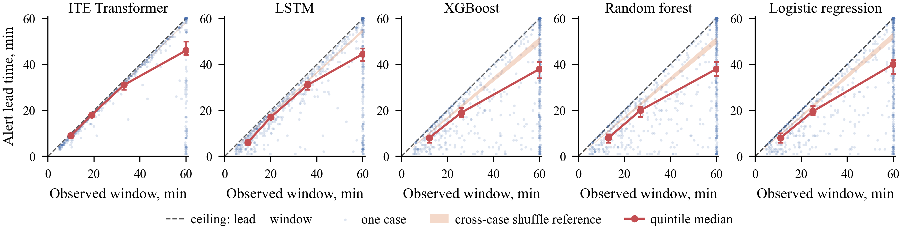
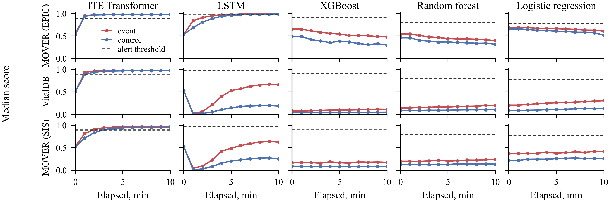
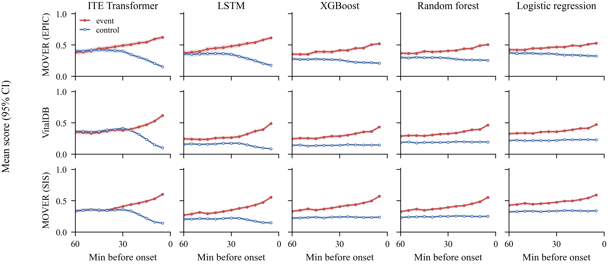
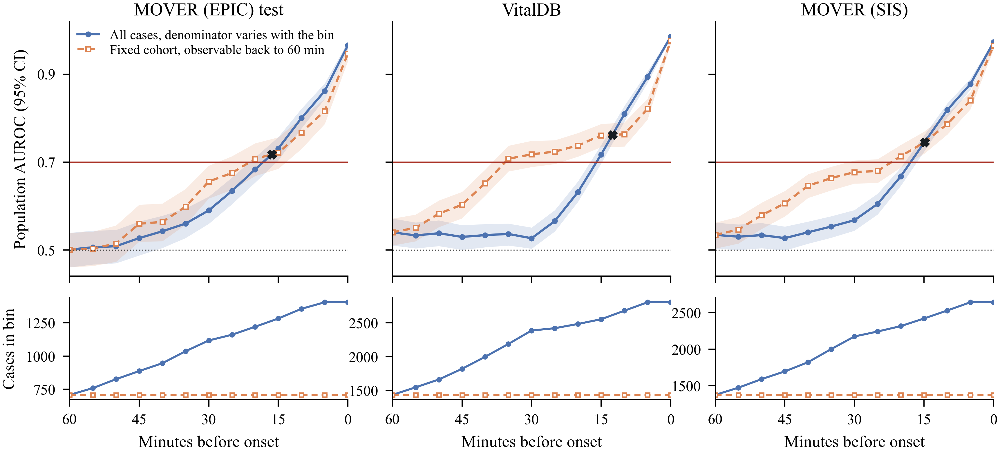

<!--
PAPER.md is the single source of truth. PAPER_REVIEW.md, PAPER.docx, latex/body.tex and
latex/main.pdf are all generated. Edits go here, then ./render.sh.

Every number below is verified against its source CSV by verify_numbers.py and every table
cell by verify_tables.py. Do not transcribe from a REPORT.md.

CAMERA-READY (2026-11-02): de-anonymised. The prior AKI work (lee2026aki) is the authors'
own and is now cited as such.
-->

# Abstract

Continuously monitored clinical prediction models are often summarized by a median alert lead
time: how many minutes before an event the first alert fires. A first alert can only fall inside
the window over which a patient was observed before the event, so the number depends on the
cohort's distribution of those windows as well as on the model. We measure how much, and what
else the number leaves out. Across three perioperative cohorts and five model families, with
alert thresholds fixed on one development validation split and transported unchanged, median
lead among detected event cases rises by 26 to 54 minutes from the shortest to the longest band
of observed window, in all fifteen model-by-cohort combinations. Longer reported leads also came
with worse operating points: across the fifteen combinations median lead ran opposite to
case-level specificity (Spearman −0.803), and the longest median lead, 24 minutes, was read at a
specificity of 0.406. Two natural repairs, discounting alerts already active at the first
monitored minute and suppressing the first minutes of monitoring, leave the dependence in place.
An item-by-item TRIPOD+AI review found no item that asks for the window distribution or for the
lead to be reported beside its operating point, and none of six published first-crossing lead-time reports we examined, our own earlier work among them, gives the window distribution. We propose four
task-specific disclosures that make a reported lead time interpretable.

# 1 Introduction

**A lead time is the number a monitoring model is sold on.** A model that is read continuously
during care is asked how early it warns, and the usual answer is the **median alert lead time**:
the interval between the first minute a case's score crosses an alert threshold and the onset of
the event, taken over the event cases the model detected. It is reported for sepsis
[@wong2021sepsis], for acute kidney injury [@lee2026aki], and for intraoperative hypotension,
where a commercial index is evaluated on the interval between its alert and the event
[@hatib2018hpi; @davies2020hpi; @wijnberge2020hype; @maheshwari2020hpi]. The label is already
plain language, so it travels well beyond the paper that computed it: "the system warns a median
of 24 minutes ahead" reads as a property of the system, to a clinician, a purchaser or a
regulator alike.

**The number also measures how long patients were watched.** A first crossing can only be found
inside the pre-onset window over which the patient was observed, so the lead is bounded above by
that window, and the window is set by when the event happens relative to the start of monitoring,
not by the model. That a lead cannot exceed its window is obvious. What has not been measured is
how large the resulting dependence is in realistic evaluation pipelines, and what else a long
reported lead conceals. Both matter for reporting: if the dependence is small, a pooled median is
a fair summary; if it is large, a median reported without its window distribution and its
operating point cannot be compared across cohorts or read as warning capability. Table 1 sets
each reading the label invites beside what the number supports in our data.

**Table 1 | What the label invites, and what the number supports.** Column one is the reading
the label makes available, not a measured reader response. Column two is what this paper's
measurements support, and column three the disclosure that would separate the two.

| What the label invites | What the number supports here | The disclosure that would close the gap |
|:--------------------|:--------------------------------------------|:---------------------------------|
| The model warns about 24 minutes ahead | A median over detected event cases, itself a window-dependent set, under this cohort's window distribution (Section 3) | The pre-onset window distribution, and a window-conditional timing statistic (Section 6.3) |
| Twenty-four minutes is a property of the model | Within one model and cohort, median lead rises across window bands by 26 to 54 minutes, in 15 of 15 cells (Table 2) | Any single median stratified by the realized available window (Section 6.3) |
| Twenty-four minutes of usable warning | A lead read at case-level specificity 0.406, the lowest of the five families in that cohort (Table 2) | The operating point reported beside the lead (Section 4) |
| A longer lead indicates a better model | Lead runs opposite to specificity across the fifteen combinations, Spearman −0.803 (Section 4) | Lead and operating point reported together, not lead alone (Section 6.3) |

**What we find.** On three perioperative cohorts and five model families:

1. **The dependence is large.** Median lead rises by 26 to 54 minutes from the shortest to the
   longest band of observed window in all fifteen model-by-cohort cells (Section 3, Table 2,
   Figure 1).
2. **A longer reported lead came with a worse operating point.** Across the fifteen cells median
   lead runs opposite to case-level specificity, and the system with the longest leads has the
   lowest specificity and the lowest case-level AUROC in every cohort (Section 4).
3. **Two natural repairs do not remove it.** Window-conditional statistics reduce it, at a cost
   (Section 5).
4. **The reporting standard does not ask for what would reveal it, and published reports do not
   give it.** We map the case onto an author-completed TRIPOD+AI [@collins2024tripodai] checklist,
   find that none of six published lead-time reports gives the window distribution, though three
   give the operating point beside the lead (Table 3), and propose four disclosures for continuously monitored models
   (Section 6).

**Related work.** Early-warning evaluation has been criticized before: the C-statistic has been
argued uninformative for early warning scores, with per-alert and workload measures proposed
instead [@romerobrufau2015cstatistic]; monitor alerting has been quantified as an
alarm burden per patient-day [@paine2016alerts]; the choice of evaluation sample moves reported performance for
this exact task on these public data [@yang2025selection]; the task's retrospective traces its arc
from hope to hype [@michard2023hype]; and cross-center evaluation separates learned methods from
pressure-derived rules far less cleanly than single-center reports suggest
[@chaari2026crosscenter]. Closest in spirit, @lauritsen2021framing shows discrimination and
calibration moving with the developer's choice of observation, prediction and lead windows, and
asks that a standard record those choices. Here the window is not a design choice but a
realized, patient-varying quantity, and what moves is the timing statistic itself.
This paper grows out of our own earlier work on acute kidney injury [@lee2026aki], which evaluated
the same transformer family under simulated continuous monitoring and reported median lead times
of 73 to 93 hours as a pooled summary. The present paper asks what such a summary needs beside it
to be read correctly, and Table 3 scores that earlier report together with the others.

# 2 Setting

**Task and outcome.** Intraoperative hypotension is mean arterial pressure (MAP) below 65 mmHg
sustained for at least three consecutive minutes. The 65 mmHg level is conventional
[@salmasi2017ioh; @sessler2019poqi]; the three-minute sustain is this study's operationalization.
Accumulated exposure is associated with kidney and myocardial injury after surgery
[@walsh2013map; @salmasi2017ioh; @wesselink2018ioh], and none of the responses acts instantly, so
a warning interval is worth what a clinician can deliver inside it.

**Cohorts.** Models were developed on the EPIC arm of MOVER and evaluated on its held-out test
split (1,404 cases, 786 with a sustained event) and on two external cohorts: VitalDB
[@lee2022vitaldb; @lee2022vitaldbdataset], with 2,804 cases and 1,007 events, and the SIS arm of
MOVER [@samad2023mover; @samad2023moverdataset], with 2,641 cases and 1,409 events. The two MOVER
arms come from one hospital and were de-identified separately, so patient overlap between them
cannot be measured; VitalDB, from a different country and health system, has no such question.
All intervals are 95% cluster bootstrap, over patients, or over cases in MOVER (SIS), which
releases no usable subject key.

**Models.** Five families: a transformer over irregularly sampled (type, time, value) triplets
[@tipirneni2022strats], the ITE (initial triplet embedding) Transformer; an LSTM; XGBoost; random
forest; and logistic regression. Appendix A.1 gives architectures, training and compute. No model
is proposed for clinical use, and nothing here is a ranking of architectures.

**Deployment simulation and operating point.** Every model is read forward at every eligible
minute of every case, using only measurements recorded before that minute and after a
source-specific induction exclusion. A case **alerts** if its score reaches the threshold at any
minute in the 60 minutes before the event, and its **lead time** is the interval from the first
such minute to the event. **Case-level sensitivity** is the share of event cases that alert and
**case-level specificity** the share of control cases that never do. Thresholds were fitted on
the development validation split at an 80% case-level sensitivity target and **transported**
unchanged to every cohort; nothing is reselected, retrained or re-scored.

**The window the rule searches.** A case's **available pre-onset window** is its observable
run-up to onset after the induction exclusion, capped at the 60-minute alert window. A short
window is not a poorly monitored case: the event arrived early in the record, so there is no
missing data to recover. An alert already active at a case's first eligible minute is
**prevalent**. Control cases take a pseudo-onset sampled from the event cases' timing
distribution, so they are scored over a comparable window.

# 3 The reported lead moves with the observed window by up to 54 minutes

**Median lead rises with window length in all fifteen model-by-cohort cells, by 26 to 54
minutes** (Table 2). Splitting detected event cases into quantile-derived bands of available
window, the rise from the shortest to the longest band has a pointwise interval excluding zero in
**15 of 15** cells, and amounts to **0.51 to 1.02 minutes of lead per minute of window
difference** (Table A1). For the transformer the shortest-window band reports 5 to 9 minutes and
the longest 46 to 59; its pooled median of 17 to 24 minutes sits between them because that is
where the median case happens to fall (Figure 1, Table A2). A pooled median is therefore as much
a description of the cohort's window distribution as of the model.

**Table 2 | Lead time, its window dependence, and the operating point it was read at.** One row
per model and cohort, at the transported 80%-sensitivity threshold. `Band lead` is the
median lead, in minutes, in the shortest and the longest band of available pre-onset window, and `Rise` their
difference (intervals, Table A1). `Pooled lead` is the single median, in minutes, a paper would report.
Sensitivity and specificity are case-level (Section 2; intervals, Table A6). `Case AUROC` is the
threshold-free discrimination of the case's maximum score over its alert window, the statistic
the alert rule thresholds, with its 95% cluster bootstrap interval.

| Model | Cohort | Band lead | Rise | Pooled lead | Sens. | Spec. | Case AUROC (95% CI) |
|:--------------|:-------------|:---------|-------:|-------:|------:|------:|---------------:|
| Transformer | MOVER (EPIC) | 9 → 46 | +37 | 24 | 0.777 | 0.406 | 0.651 [0.621, 0.677] |
| Transformer | VitalDB | 5 → 59 | +54 | 17 | 0.679 | 0.379 | 0.642 [0.619, 0.665] |
| Transformer | MOVER (SIS) | 6 → 46 | +40 | 22 | 0.657 | 0.467 | 0.641 [0.621, 0.662] |
| LSTM | MOVER (EPIC) | 6 → 44 | +38 | 23 | 0.807 | 0.474 | 0.693 [0.667, 0.719] |
| LSTM | VitalDB | 3 → 34 | +31 | 9 | 0.492 | 0.812 | 0.771 [0.754, 0.787] |
| LSTM | MOVER (SIS) | 5 → 31 | +26 | 15 | 0.551 | 0.709 | 0.716 [0.694, 0.736] |
| XGBoost | MOVER (EPIC) | 8 → 38 | +30 | 21 | 0.810 | 0.608 | 0.766 [0.741, 0.791] |
| XGBoost | VitalDB | 3 → 30 | +27 | 13 | 0.694 | 0.754 | 0.807 [0.792, 0.822] |
| XGBoost | MOVER (SIS) | 5 → 36 | +31 | 19 | 0.790 | 0.638 | 0.773 [0.754, 0.792] |
| Random forest | MOVER (EPIC) | 8 → 38 | +30 | 22 | 0.828 | 0.555 | 0.746 [0.717, 0.772] |
| Random forest | VitalDB | 3 → 34 | +31 | 15 | 0.803 | 0.674 | 0.793 [0.777, 0.809] |
| Random forest | MOVER (SIS) | 6 → 40 | +34 | 22 | 0.849 | 0.559 | 0.764 [0.746, 0.781] |
| Logistic reg. | MOVER (EPIC) | 8 → 40 | +32 | 23 | 0.837 | 0.518 | 0.718 [0.690, 0.746] |
| Logistic reg. | VitalDB | 3 → 28 | +26 | 14 | 0.461 | 0.825 | 0.776 [0.760, 0.793] |
| Logistic reg. | MOVER (SIS) | 5 → 38 | +33 | 21 | 0.790 | 0.585 | 0.723 [0.703, 0.743] |

**Figure 1 | Alert lead time against the available pre-onset window.** Every detected event
case under the ITE Transformer, three held-out cohorts; the five-family version is Figure A1. The
dashed diagonal is the ceiling. The shaded band is the 2.5th to 97.5th percentile envelope of the
cross-case shuffle reference, not a per-case prediction interval. Red markers are the band
medians of Table A2 with 95% cluster bootstrap intervals.

**The same fact as a ratio.** The median ratio of a case's lead to its own window is 0.455 to
0.944, and the Spearman correlation between lead and window is 0.501 to 0.906, across all fifteen
cells. The transformer is the extreme at 0.899 to 0.944, its first alert falling 90 to 94% of the
way back to the start of the window it was given; logistic regression in VitalDB (0.455) and
XGBoost in VitalDB (0.467) place the first alert nearer the middle. Detection itself also depends
on window length, by 0.105 to 0.556 in the detected share across bands, falling in the two
sequence models and rising in the three tabular ones (Table A3), so for the tabular families part
of the rise may be survivorship.

**How much of this exceeds the ceiling, we cannot say, and the reporting point does not depend
on it.** Because a lead cannot exceed its window, some positive dependence arises by
construction. A reference that places a pseudo-crossing uniformly on each case's window has
median ratio 0.518 to 0.534, which the transformer's observed ratio exceeds by **+0.372 to
+0.421**; in **2 of 15** cells, all VitalDB, the observed ratio sits *below* it. A cross-case
shuffle that gives each case another case's score sequence reproduces the association: its median
ratio is **0.72 to 0.97** and its Spearman **0.63 to 0.94**, at or above the observed value in
**15 of 15** cells, and a length-matched variant is **not distinguishable from the observed
correlation in 9 of 15 cells** (Table A4). Both shuffles are biased toward agreement, so they
bound nothing; we do not claim a patient-specific fraction. For reporting this does not matter:
whatever its source, a pooled median mixes cases whose leads differ by tens of minutes because
their windows did.

# 4 Longer reported leads came with worse operating points

**Across the fifteen cells, median lead runs opposite to case-level specificity** (Spearman
−0.803; 86 of 99 untied pairs) and to PPV in excess of prevalence (−0.719). The ordering holds
within each cohort, where the window distribution is shared: 9 of 9 untied pairs in MOVER (EPIC),
8 of 10 in VitalDB and 9 of 9 in MOVER (SIS), Spearman −0.97, −0.70 and −0.97. We attach no test,
because the fifteen cells share cohorts and fits and are not independent replications, and a
transported threshold yields realized sensitivities from 0.461 to 0.849 (Table 2), so this is a
description of operating points as transported, not a sensitivity-matched comparison. What it
shows is enough for reporting: **a reader ranking these systems by their published lead would be
ranking them against their operating points.**

**The transformer has the longest leads, the lowest specificity and the lowest case-level AUROC
in every cohort.** Its median leads, 24, 17 and 22 minutes, are the longest of the five families
in two cohorts and tied for longest in the third. Its specificity is 0.406, 0.379 and 0.467, so it
alerts on 53 to 62% of control cases, and its PPV sits 0.065, 0.021 and 0.051 above prevalence.
Its case-level AUROC is 0.651, 0.642 and 0.641, against 0.693 to 0.807 for the other four
families (Table 2), so the low specificity reflects a weak case-level discriminator and not only
a badly placed threshold. A reader given only "24 minutes" sees none of this.

**The mechanism is simple: its score is above threshold almost from the first minute.** Within
three minutes of its first scored minute the transformer's median score clears its own threshold
in every cohort, in event and control cases alike; in MOVER (EPIC) it rises from 0.530 to 0.938
in one minute in control cases and from 0.541 to 0.951 in event cases, against a threshold of
**0.894** (Figure A2, Appendix A.7). A case whose score settles above threshold that early
registers its first crossing as soon as its alert window opens, so its lead is whatever that
window holds. **20.0 to 52.3% of the transformer's event minutes and 2.5 to 18.3% of its control
minutes** sit at or above threshold, against 0 to 26.7% and 0 to 1.7% for the other four families.

**The window dependence does not need a degenerate model.** XGBoost and the random forest have
specificity 0.555 to 0.754 and case-level AUROC 0.746 to 0.807, usable operating points by the
standard of this task, and their median leads still rise by 27 to 34 minutes across window bands
(Table 2). The transformer makes the specificity cost visible; the window dependence is present
in every family.

**None of this is a statement about physiology.** MAP is both an input channel and the quantity
the label is computed from, so nothing here shows that a score foresees a physiological process.
Under a pre-specified rule the score does not depart from its own baseline before MAP departs from
its (Appendix A.12).

# 5 Two natural repairs, and why neither works

**Prevalent alerts are not the explanation.** Alerts already active at the first eligible minute
are **2.6 to 25.5%** of detected event cases across the fifteen cells, and recomputing the median
lead on the remaining alerts alone costs **0 to 3 minutes in all fifteen cells** (Figure 2,
Appendix A.13). The window dependence is carried by ordinary cases. Prevalence stays low because
most detected event cases have windows shorter than 60 minutes that open while the score is still
settling: a prevalent alert and a warm-up crossing are the same behavior either side of the first
eligible minute, which is why Figure 2 shows both.

**Figure 2 | Composition of detected event cases by elapsed monitoring time at the first
crossing.** Prevalent cases are above threshold at their first eligible minute; warm-up cases
cross within five minutes of it; settled cases cross later. Five model families, three cohorts,
at the transported 80%-sensitivity operating point. The transformer's alerts are concentrated in
the first five minutes, the LSTM's partly so and the tabular families' not, while the window
dependence of Section 3 holds in all of them. This is the stacked bar Section 6.3's first item
asks for.

**Suppressing the first minutes of monitoring is a poor trade.** Discarding every minute at or
before *N* = 5 minutes of elapsed monitoring and applying the unchanged threshold costs **3.6 to
6.8 percentage points of case-level sensitivity** for **0 to 3.2 percentage points of
specificity**, and moves median lead by **−3 to +1 minutes**, in two cells *increasing* it
because short-window cases drop out of the detected set. The surviving alerts still fire at the
first opportunity within whatever window remains. Lowering the threshold to restore sensitivity
cannot recover more specificity than the fixed-threshold gain, since suppression only removes
alerting minutes. **We do not recommend the rule**: the problem is not noisy early minutes but the
coupling of the reported quantity to the window it is measured in.

**Window-conditional statistics reduce the dependence, at a cost.** Both repairs above change the
alert rule and keep the estimand; the alternative is to change the estimand, as landmarking does
[@vanhouwelingen2007landmark]. A **horizon-specific detection rate**, over event cases observed
for at least *X* minutes before onset, runs 0.278 to 0.692 at a 10-minute horizon and 0.173 to
0.547 at 30 minutes, a smooth decline a single median hides (Table A8); cases observed longer than
*X* still contribute unequal alerting opportunity. **Restricting to cases observed for the whole
60-minute window** makes the window constant: the transformer then reports the longest median
lead of the five families in all three cohorts, 47, 60 and 57 minutes, while detecting only
0.441, 0.247 and 0.304 of those cases against 0.762 to 0.910 for XGBoost and the random forest
(Table A9). The restriction discards 53 to 60% of event cases, the short-window cases a deployed
monitor will meet, and those cases differ in surgery duration and case mix (Appendix A.16).
Neither statistic repairs the pooled median; both make visible what it hides.

# 6 What TRIPOD+AI asks for, and four disclosures

A clinician, a regulator or a procurement reviewer meets a reported lead as a number and a name,
not as a scoring policy, so what a reporting standard requires alongside it limits what any of
them can conclude. We therefore ask what TRIPOD+AI [@collins2024tripodai] guarantees a reader
receives next to a lead time, and whether published reports supply the rest.

## 6.1 The standard asks for the ingredients, not the pairing

The authors completed an item-level TRIPOD+AI review for this work before the analyses of
Sections 3 to 5 were run. TRIPOD+AI is a general minimum reporting standard for prediction
models, not an alerting-rule standard, so what follows identifies where a task-specific
complement is needed rather than a failure of the standard.

**Item 12e, performance measures and rationale**, is where a lead time is declared; it asks which
measures were used and why, not what else a measure responds to. **Item 15** addresses model
output and threshold selection and **item 23a** performance estimates with uncertainty, but
neither requires a lead-time summary to be presented with its realized operating point. **Items
20a and 20b come closest**: both ask for follow-up time among the participant characteristics,
and this study answers them with surgery duration and first-onset time. The raw material is
therefore requested, as a cohort descriptor. What is not requested is the distribution of the
window the alert rule searches, or any pairing of it with the timing statistic it bounds, though
that window correlates with the reported lead at ρ = 0.501 to 0.906. **Item 14, model fairness**,
is a near miss of a different kind: our answer to it already disclosed that arterial-line
placement selects longer, higher-risk operations, filed as a limitation of generalizability, and
nothing in the standard connects it to the timing metric. The remaining near misses are in Table
A10. We checked TRIPOD+AI only; DECIDE-AI and TRIPOD-LLM were not reviewed.

## 6.2 Published reports give the lead without its window

**None of six published first-crossing lead-time reports we examined gives the distribution of
the window the first alert was searched in, or stratifies the lead by it** (Table 3). The most
any gives is length of stay as a cohort descriptor or a figure of per-patient observation not
linked to the lead. The operating point fares better: three put sensitivity and specificity in
the same sentence or table row as the lead, and @churpek2020aki does so for every threshold,
which is the pairing Section 6.3 asks for. Our own earlier report is among those that omit the
window, though its cohort required at least 72 hours of pre-event data. These are reports we had
collected, not a systematic sample, so they show that the omission occurs in practice, not how
often. Fixed-horizon designs, such as the derivation of the hypotension prediction index
[@hatib2018hpi; @davies2020hpi], are not first-crossing statistics and are not scored.

**Table 3 | Six published reports of a first-crossing lead time, scored against Section 6.3.**
`Window` is whether the distribution of pre-event observation time is reported or the lead
stratified by it; `Operating point` is whether sensitivity and specificity (or PPV) appear beside
the lead. Values are as printed in each paper; h, hours.

| Report | Task | Reported lead, median (IQR) | Window | Operating point beside lead |
|:----------|:----------|:--------------|:--------------|:------------------|
| @henry2015trewscore | Septic shock | 28.2 h (10.6–94.2) | Figure only, truncated at 120 h | Yes, same sentence |
| @kang2016realtime | Ward deterioration | 24.7 h and 29.6 h | No; length of stay only | Threshold only; specificity elsewhere |
| @koyner2018aki | Acute kidney injury | 41 h (12–141) | No; length of stay only | Yes, adjacent sentence, for a 24-hour target |
| @giannini2019sepsis | Severe sepsis | 6 h 34 min (0 h 50 min–53 h 19 min) | No | Elsewhere, from a separate cohort |
| @churpek2020aki | Acute kidney injury | 27, 34.5 and 39 h, three sites | Cumulative incidence figure only | Yes, same table row |
| @lee2026aki | Acute kidney injury | 84, 93 and 73 h, three cohorts | No; length of stay only | Threshold only; detection and alert burden at another threshold |

## 6.3 Four disclosures for continuously monitored models

Each is tied to a measurement in this paper and computable from artifacts a study of this kind
already produces; none requires a new experiment.

1. **Alert composition by elapsed observation time**: for every operating point, the prevalent,
   warm-up and settled shares of alerts, as in Figure 2. One stacked bar would have made Section 4
   visible on sight.
2. **A window-conditional timing statistic, with the window distribution**: a horizon-specific
   detection curve or a fixed-window estimand as the primary timing quantity, with its
   denominator stated, and any single median stratified by available pre-onset window (Section 3,
   Tables A8 and A9).
3. **The operating point beside the lead, and N(t) beside any event-aligned curve.** Specificity
   or PPV belongs in the same row as the lead (Table 2). For trajectories, the risk set here
   roughly halves between the event and 60 minutes before it (1,404 to 708, 2,804 to 1,433 and
   2,641 to 1,374), and recomputing the same bins on only the cases observable back to 60 minutes
   moves the first bin reaching AUROC 0.70 from 15 minutes in all three cohorts to 20, 35 and 20
   (Figure A4): the horizon a reader would quote moves by up to twenty minutes on a reporting
   choice alone.
4. **A path-versus-displacement summary for any score read as a trend**, so that a series
   traveling much farther than its net displacement is not described as rising (Table A5,
   Appendix A.9). This is closer to a diagnostic than a disclosure, and the weakest of the four.

**Four items are a burden, so they should replace text rather than add to it.** Each is one
figure or one row beside a number a paper already reports. If a report has room for only one, it
should be the operating point in the same row as the lead: that alone would have shown that the
longest lead here came with the worst specificity.

The specific magnitudes do not generalize; the structure does. Any continuously read model
evaluated with a first-crossing statistic over patient-varying windows is susceptible, and the
size of the effect has to be measured in each setting. The reporting conclusion is narrow: report
a median lead beside its window distribution and its operating point, never alone.

# 7 Limitations

**Retrospective, one label, one fit.** Every score comes from a retrospective forward-running
simulation on cached data, not deployment. The outcome's level and duration are conventions we
did not vary. Models were trained at one seed and thresholds come from one validation split at one
sensitivity target; a different fit or target could move the magnitudes in Sections 3 to 5.
Control cases have no onset, so each takes one pseudo-onset drawn at a fixed seed, and every
control-side quantity (specificity, PPV, the association of Section 4) is conditional on that
draw; its variability is not in any interval we report.

**Two cohorts share a hospital.** MOVER's EPIC and SIS arms come from the same site and were
de-identified separately, so patients may appear in both the development cohort and MOVER (SIS),
and that overlap cannot be measured. VitalDB, from another country and health system, is the
external cohort without this caveat, and both main results, the window dependence and the
lead-specificity ordering, hold in it.

**The references cannot apportion the effect.** Both shuffle references are biased toward
agreement and change which cases are detected, so they bound nothing (Section 3).

**The headline exemplar is a weak model.** The transformer's 24 minutes comes with case-level
AUROC near 0.65, and no one would deploy it at that operating point. The window dependence does
not rest on it (Section 4), but the specificity contrast is sharpest there.

**Affordance, not comprehension, and one domain.** We analyze what a reporting convention makes
inferable, not what readers actually infer; measuring that is the next study, and Section 6.3's
items are what it would test. The four items are demonstrated here, not validated across
settings, and three cohorts in two countries still give one procedure setting and one monitored
variable. The six reports of Table 3 show that the omission occurs, not how
often; a systematic survey of reported lead times would.

# Acknowledgments and Disclosure of Funding

This work received no funding. The authors declare no competing interests.

**Use of generative artificial intelligence.** The authors used coding assistants (Claude Code,
Anthropic; Codex, OpenAI) during this work, to implement analyses from author-specified designs,
to generate figures from verified analysis outputs, and to draft and language-edit the text.
Analytical approaches the tools proposed were adopted only after author review. Every number in
the paper is re-derived from the aggregate result files and checked against the text by an
automated gate that fails on any disagreement; the authors reviewed and verified all code,
results and text and take full responsibility for the paper.

# Appendix A: methods and complete per-cell results

## Cohorts, models, training and compute

**Cohorts and eligibility.** Two public datasets supply the three cohorts: VitalDB, and
MOVER, whose single release carries both an EPIC-derived and an SIS-derived arm. Both are de-identified. VitalDB v1.0.0 is openly accessible from PhysioNet under the Creative Commons Attribution 4.0 International (CC BY 4.0) license; MOVER is available from the UCI Machine Learning Repository to researchers who sign its data use agreement. Development
used MOVER's EPIC arm. The subject-aware split at
seed 1004 gave 6,409 training, 1,375 validation and 1,404 test cases
out of 9,188, split on unique subject identifiers so that a patient with several operations
lands in one fold. The test split holds 1,404 cases, 786 with a sustained event, 1,145 subjects.
External evaluation used VitalDB, with 2,804 cases, 1,007 events and 2,730 subjects, and the
SIS-derived arm of MOVER, with 2,641 cases and 1,409 events, neither of which contributed to training, calibration or threshold selection. Neither arm of MOVER carries a subject key that resolves against the other, so that statement holds at the level of the released records and cannot be checked at the level of patients. Per-minute eligibility
drops the induction prefix, 25 minutes where the record is anchored on anesthesia start, 10
where it is anchored on surgical start, and every minute at or after first onset, so no
model is asked to predict an event already in progress. Event cases required five valid
pre-onset minutes after that exclusion and controls thirty. Procedure group is never a model
input in any family: it separates the cohorts almost perfectly and would be learned as cohort
identity.

**Training samples, labels and the offset used here.** Training uses one sample per case: the
120-minute window ending at that case's reference time, labeled 1 if the case has a sustained
event and 0 otherwise. There is no per-minute training target. For an event case the reference
time is the first sustained-onset minute shifted back by a lead-time offset, and that offset is
**zero for every model reported in this paper**, so the reference time is onset itself. A control
has no onset, so it is given a sampled pseudo-onset: its onset ratio, onset divided by case
length, is drawn with replacement from the event cases of the same source cohort and multiplied
by the control's own case length, then resampled rather than clipped until it falls inside the
eligible range, so the control reference times match the event distribution within each source.
Event cases with fewer than five eligible pre-onset minutes and controls shorter than thirty are
dropped before that sampling. The scored checkpoint is the epoch with the best validation AUROC,
and it is the only one used. Evaluation departs from training in the one respect that matters
here: every eligible minute of a case is scored independently and inherits its case's label, and
`t_to_event` is measured against that same reference time, real onset for an event case and the
sampled pseudo-onset for a control.

**Features.** The same twenty inputs for every family: sixteen per-minute channels, being
MAP, systolic and diastolic pressure, their non-invasive counterparts, heart rate, SpO2,
end-tidal CO2, temperature, FiO2, MAC, tidal volume, respiratory rate, PEEP and peak
inspiratory pressure, and four demographics, being age, sex, height and weight. The families
differ in how they consume them. The transformer takes each non-missing cell as a
(type, time, value) triplet with demographics as a fixed prefix at time zero, up to 2,048
tokens over a 120-minute window, so missing cells produce no token and are never imputed. The
LSTM takes the normalized per-minute window as a value-and-mask pair per channel. Logistic
regression, random forest and XGBoost take the last observation carried forward per channel
plus the demographics. Per-channel median and interquartile scaling was fitted on the
training cases alone and applied unchanged everywhere else.

**Architectures and training.** Seed 1004 throughout. The transformer is a STraTS-style
encoder, a type embedding plus a value MLP plus a time MLP summed per triplet, two encoder
layers, model width 128, four heads, feed-forward width 512, dropout 0.1, a learnable
classification token and a two-class softmax head; AdamW at learning rate 1.2e-3, weight
decay 1e-2 applied to two-dimensional tensors only, gradient clipping at 1.0, a cosine
schedule with 5% warmup, batch size 64, cross-entropy, up to 50 epochs with early stopping on
validation AUROC at patience 10, under bfloat16 autocast. The LSTM is one layer of width 128
with dropout 0.1, AdamW at 1e-3 with weight decay 1e-2, batch size 64, up to 40 epochs at
patience 8. Logistic regression is median imputation and standardization followed by an L2
fit at up to 2,000 iterations. The random forest is 400 trees. XGBoost is 600 rounds at depth
6, learning rate 0.05, row and column subsampling at 0.8, histogram tree method, early
stopping after 40 rounds on validation AUC. No hyperparameter search was run over any of
these values.

**Compute.** Every model was trained on one Apple M3 Ultra desktop with 512 GB of unified
memory, using PyTorch 2.10 on the Metal backend with bfloat16 autocast; no GPU cluster was
used. Wall clock for the five models reported here was 40.3 minutes for the transformer, 14.5
for the LSTM, 3.6 for the random forest, and 34 and 33 seconds for XGBoost and logistic
regression. The project trained more than this paper reports: each family was also trained at
seven lead-time offsets, of which the transformer arm alone took 3.8 hours. The analyses in
this paper add no training and read cached per-minute scores on the same machine. Software
was PyTorch 2.10.0, scikit-learn 1.7.1, XGBoost 3.3.0, NumPy
2.2.6, pandas 2.3.2 and SciPy 1.16.1.

**Data and code.** Both source datasets are public and de-identified. VitalDB v1.0.0 is openly accessible from PhysioNet under the Creative Commons Attribution 4.0 International (CC BY 4.0) license; MOVER is available from the UCI Machine Learning Repository under its data use agreement, one download supplying both arms used here. The Institutional Review Board of Ewha Womans University Mokdong Hospital granted an exemption from review and waived informed consent for this secondary analysis of publicly available
de-identified data (EUMC 2026-08-011). This work
added no data collection and no patient contact. Analysis code is available at **[TODO-REPO-URL]**, under the Apache License 2.0.
The repository carries the analysis code and the aggregate result files behind the tables and figures, and no patient-level or derived patient-level data of any kind; each dataset is obtained from its own provider under the access and license terms above.

## Lead time by quantile-derived band of observed window, all fifteen cells

**Table A1 | Median alert lead time by quantile-derived band of observed window, all fifteen
cells.** Main text Section 3 reports the ITE Transformer. The gradient is positive in
every cell.
`Bands` is the number of quantile-derived groups actually realized: where the observed window is censored
at the 60-minute alert window the upper quintiles collapse onto a single value, and
duplicate edges are dropped rather than bands invented.
The gradient is the difference of the highest and lowest band medians, and its interval is the
paired cluster bootstrap of that difference: one weight matrix is drawn per cell and reused
across bands, and the band edges and the window span are held fixed at their full-sample values
so the ratio's denominator is not itself resampled. The interval excludes zero in all fifteen
cells. Band medians and gradients are displayed rounded to the minute but computed on unrounded
values, so where a band median falls on a half-minute a row's displayed endpoints need not
differ by exactly the displayed gradient; logistic regression under VitalDB is the one row
where they do not. `Lead min per window min` is the ratio of those two between-band median contrasts and not
a per-case slope, so a value slightly above 1.0 carries no contradiction with the per-case
constraint that a lead cannot exceed its own window.

| Model | Cohort | Bands | Window Q1→last, min | Lead Q1→last, min | Gradient, min (95% CI) | Lead min per window min (95% CI) |
|---|---|---:|---|---|---|---|
| ITE Transformer | MOVER (EPIC) test | 4 | 10 → 60 | 9 → 46 | +37 [+35, +41] | 0.74 [0.70, 0.82] |
| ITE Transformer | VitalDB | 5 | 7 → 60 | 5 → 59 | +54 [+51, +55] | 1.02 [0.96, 1.04] |
| ITE Transformer | MOVER (SIS) | 4 | 8 → 60 | 6 → 46 | +40 [+37, +43] | 0.77 [0.71, 0.83] |
| LSTM | MOVER (EPIC) test | 4 | 10 → 60 | 6 → 44 | +38 [+35, +41] | 0.77 [0.70, 0.82] |
| LSTM | VitalDB | 5 | 6 → 60 | 3 → 34 | +31 [+21, +48] | 0.57 [0.39, 0.89] |
| LSTM | MOVER (SIS) | 4 | 9 → 60 | 5 → 31 | +26 [+19, +30] | 0.51 [0.37, 0.59] |
| XGBoost | MOVER (EPIC) test | 3 | 12 → 60 | 8 → 38 | +30 [+26, +34] | 0.62 [0.54, 0.71] |
| XGBoost | VitalDB | 3 | 9 → 60 | 3 → 30 | +27 [+22, +30] | 0.53 [0.43, 0.58] |
| XGBoost | MOVER (SIS) | 3 | 12 → 60 | 5 → 36 | +31 [+28, +33] | 0.65 [0.58, 0.69] |
| Random forest | MOVER (EPIC) test | 3 | 13 → 60 | 8 → 38 | +30 [+26, +34] | 0.64 [0.55, 0.72] |
| Random forest | VitalDB | 3 | 9 → 60 | 3 → 34 | +31 [+29, +34] | 0.61 [0.57, 0.67] |
| Random forest | MOVER (SIS) | 3 | 12 → 60 | 6 → 40 | +34 [+31, +36] | 0.71 [0.65, 0.75] |
| Logistic regression | MOVER (EPIC) test | 3 | 11 → 60 | 8 → 40 | +32 [+28, +35] | 0.65 [0.57, 0.71] |
| Logistic regression | VitalDB | 3 | 10 → 60 | 3 → 28 | +26 [+20, +28] | 0.51 [0.40, 0.56] |
| Logistic regression | MOVER (SIS) | 3 | 12 → 60 | 5 → 38 | +33 [+29, +36] | 0.69 [0.61, 0.75] |

## Lead time by band, the transformer's three cohorts

**Table A2 | Median alert lead time inside quantile-derived bands of observed window, ITE Transformer.** ITE
Transformer, three held-out cohorts, at the transported 80%-sensitivity operating point.
Quintile edges are cut within each cell on detected cases; where the observed window is censored
at the 60-minute alert window the upper quintiles collapse and the realized band count is
reported rather than assumed. `Observed window, min` is the median observed pre-onset window of that band's cases rather than
an edge. Intervals are 95% cluster bootstrap over subjects, or over cases in MOVER (SIS). All fifteen cells are Table A1; the detection rate these bands condition on is Table A3.
Section 3 reports the contrast this table carries.

| Cohort | Band | n | Observed window, min | Median lead, min (95% CI) | Lead / window (95% CI) |
|---|---:|---:|---:|---|---|
| MOVER (EPIC) test | 1 | 139 | 10 | 9 [8, 9] | 0.88 [0.85, 0.89] |
| MOVER (EPIC) test | 2 | 111 | 19 | 18 [17, 18] | 0.94 [0.94, 0.95] |
| MOVER (EPIC) test | 3 | 121 | 33 | 31 [29, 32] | 0.97 [0.96, 0.97] |
| MOVER (EPIC) test | 4 | 240 | 60 | 46 [44, 50] | 0.98 [0.96, 0.98] |
| VitalDB | 1 | 143 | 7 | 5 [5, 6] | 0.83 [0.83, 0.83] |
| VitalDB | 2 | 140 | 12 | 10 [10, 11] | 0.91 [0.90, 0.91] |
| VitalDB | 3 | 132 | 20 | 19 [18, 20] | 0.94 [0.94, 0.95] |
| VitalDB | 4 | 134 | 40 | 38 [37, 40] | 0.97 [0.97, 0.97] |
| VitalDB | 5 | 135 | 60 | 59 [57, 60] | 0.98 [0.98, 1.00] |
| MOVER (SIS) | 1 | 199 | 8 | 6 [5, 6] | 0.80 [0.80, 0.82] |
| MOVER (SIS) | 2 | 179 | 17 | 14 [13, 15] | 0.86 [0.84, 0.91] |
| MOVER (SIS) | 3 | 186 | 29 | 27 [26, 28] | 0.94 [0.93, 0.96] |
| MOVER (SIS) | 4 | 362 | 60 | 46 [43, 49] | 0.95 [0.93, 0.97] |

## Detection rate by band of observed window, all fifteen cells

**Table A3 | Detection rate by band of observed pre-onset window, all fifteen cells.** Bands are
quantiles of the observed window cut over **all** event cases with a positive observed window,
not over the detected subset Table A2 and Table A1 cut on, because a within-band detection rate
needs every event case of that window length in its denominator. The two banding schemes are
therefore not interchangeable; the band counts here are event-case counts rather than detected
counts, and the median leads differ from Table A1's, sometimes by several minutes. The detection rate summed over
bands reproduces the case-level sensitivity of Table A6 exactly in all fifteen cells, which is the
check that the denominators are the same event cases. Intervals are 95% cluster bootstrap.

| Model | Cohort | Band | Event cases | Detected | Window median, min | Detection rate (95% CI) | Median lead, min (95% CI) |
|---|---|---:|---:|---:|---:|---|---|
| ITE Transformer | MOVER (EPIC) test | 1 | 159 | 159 | 11 | 1.000 [1.000, 1.000] | 9 [8, 10] |
| ITE Transformer | MOVER (EPIC) test | 2 | 164 | 164 | 23 | 1.000 [1.000, 1.000] | 22 [20, 24] |
| ITE Transformer | MOVER (EPIC) test | 3 | 150 | 149 | 44 | 0.993 [0.979, 1.000] | 42 [40, 43] |
| ITE Transformer | MOVER (EPIC) test | 4 | 313 | 139 | 60 | 0.444 [0.388, 0.498] | 54 [33, 58] |
| ITE Transformer | VitalDB | 1 | 204 | 204 | 8 | 1.000 [1.000, 1.000] | 6 [6, 7] |
| ITE Transformer | VitalDB | 2 | 203 | 203 | 18 | 1.000 [1.000, 1.000] | 16 [14, 17] |
| ITE Transformer | VitalDB | 3 | 600 | 277 | 60 | 0.462 [0.421, 0.500] | 44 [42, 46] |
| ITE Transformer | MOVER (SIS) | 1 | 287 | 283 | 10 | 0.986 [0.971, 0.997] | 7 [7, 8] |
| ITE Transformer | MOVER (SIS) | 2 | 285 | 281 | 25 | 0.986 [0.971, 0.997] | 23 [22, 24] |
| ITE Transformer | MOVER (SIS) | 3 | 837 | 362 | 60 | 0.432 [0.398, 0.465] | 46 [43, 49] |
| LSTM | MOVER (EPIC) test | 1 | 159 | 148 | 11 | 0.931 [0.889, 0.970] | 7 [6, 8] |
| LSTM | MOVER (EPIC) test | 2 | 164 | 157 | 23 | 0.957 [0.925, 0.987] | 20 [18, 21] |
| LSTM | MOVER (EPIC) test | 3 | 150 | 141 | 44 | 0.940 [0.897, 0.974] | 39 [37, 41] |
| LSTM | MOVER (EPIC) test | 4 | 313 | 188 | 60 | 0.601 [0.545, 0.652] | 40 [34, 46] |
| LSTM | VitalDB | 1 | 204 | 166 | 8 | 0.814 [0.760, 0.868] | 3 [3, 4] |
| LSTM | VitalDB | 2 | 203 | 147 | 18 | 0.724 [0.660, 0.783] | 10 [9, 12] |
| LSTM | VitalDB | 3 | 600 | 182 | 60 | 0.303 [0.268, 0.340] | 32 [28, 34] |
| LSTM | MOVER (SIS) | 1 | 287 | 196 | 10 | 0.683 [0.628, 0.738] | 6 [5, 6] |
| LSTM | MOVER (SIS) | 2 | 285 | 188 | 25 | 0.660 [0.604, 0.714] | 18 [16, 21] |
| LSTM | MOVER (SIS) | 3 | 837 | 393 | 60 | 0.470 [0.437, 0.504] | 33 [29, 36] |
| XGBoost | MOVER (EPIC) test | 1 | 159 | 110 | 11 | 0.692 [0.619, 0.760] | 7 [5, 9] |
| XGBoost | MOVER (EPIC) test | 2 | 164 | 132 | 23 | 0.805 [0.743, 0.865] | 17 [16, 19] |
| XGBoost | MOVER (EPIC) test | 3 | 150 | 130 | 44 | 0.867 [0.806, 0.918] | 32 [28, 36] |
| XGBoost | MOVER (EPIC) test | 4 | 313 | 265 | 60 | 0.847 [0.806, 0.885] | 40 [34, 44] |
| XGBoost | VitalDB | 1 | 204 | 110 | 8 | 0.539 [0.471, 0.606] | 3 [2, 3] |
| XGBoost | VitalDB | 2 | 203 | 132 | 18 | 0.650 [0.587, 0.718] | 7 [5, 9] |
| XGBoost | VitalDB | 3 | 600 | 457 | 60 | 0.762 [0.728, 0.794] | 26 [23, 30] |
| XGBoost | MOVER (SIS) | 1 | 287 | 179 | 10 | 0.624 [0.570, 0.678] | 5 [4, 5] |
| XGBoost | MOVER (SIS) | 2 | 285 | 228 | 25 | 0.800 [0.753, 0.844] | 14 [13, 16] |
| XGBoost | MOVER (SIS) | 3 | 837 | 706 | 60 | 0.843 [0.819, 0.866] | 35 [33, 37] |
| Random forest | MOVER (EPIC) test | 1 | 159 | 107 | 11 | 0.673 [0.596, 0.746] | 6 [5, 8] |
| Random forest | MOVER (EPIC) test | 2 | 164 | 135 | 23 | 0.823 [0.762, 0.880] | 17 [15, 18] |
| Random forest | MOVER (EPIC) test | 3 | 150 | 129 | 44 | 0.860 [0.800, 0.914] | 30 [27, 34] |
| Random forest | MOVER (EPIC) test | 4 | 313 | 280 | 60 | 0.895 [0.861, 0.928] | 41 [35, 45] |
| Random forest | VitalDB | 1 | 204 | 140 | 8 | 0.686 [0.626, 0.747] | 3 [2, 3] |
| Random forest | VitalDB | 2 | 203 | 157 | 18 | 0.773 [0.711, 0.831] | 7 [6, 10] |
| Random forest | VitalDB | 3 | 600 | 512 | 60 | 0.853 [0.825, 0.882] | 32 [30, 35] |
| Random forest | MOVER (SIS) | 1 | 287 | 201 | 10 | 0.700 [0.646, 0.752] | 5 [5, 6] |
| Random forest | MOVER (SIS) | 2 | 285 | 245 | 25 | 0.860 [0.819, 0.899] | 16 [14, 17] |
| Random forest | MOVER (SIS) | 3 | 837 | 750 | 60 | 0.896 [0.875, 0.916] | 38 [36, 41] |
| Logistic regression | MOVER (EPIC) test | 1 | 159 | 119 | 11 | 0.748 [0.678, 0.814] | 7 [6, 9] |
| Logistic regression | MOVER (EPIC) test | 2 | 164 | 138 | 23 | 0.841 [0.787, 0.896] | 18 [17, 20] |
| Logistic regression | MOVER (EPIC) test | 3 | 150 | 134 | 44 | 0.893 [0.843, 0.940] | 36 [32, 38] |
| Logistic regression | MOVER (EPIC) test | 4 | 313 | 267 | 60 | 0.853 [0.812, 0.892] | 42 [36, 46] |
| Logistic regression | VitalDB | 1 | 204 | 71 | 8 | 0.348 [0.283, 0.412] | 3 [2, 3] |
| Logistic regression | VitalDB | 2 | 203 | 95 | 18 | 0.468 [0.404, 0.539] | 7 [6, 8] |
| Logistic regression | VitalDB | 3 | 600 | 298 | 60 | 0.497 [0.454, 0.537] | 26 [22, 30] |
| Logistic regression | MOVER (SIS) | 1 | 287 | 178 | 10 | 0.620 [0.566, 0.676] | 5 [5, 5] |
| Logistic regression | MOVER (SIS) | 2 | 285 | 221 | 25 | 0.775 [0.727, 0.821] | 14 [12, 16] |
| Logistic regression | MOVER (SIS) | 3 | 837 | 714 | 60 | 0.853 [0.829, 0.876] | 36 [34, 38] |

## The relationship in all five families

Figure 1 plots the transformer in three cohorts. The lead-to-window relationship it shows is
not particular to that model: in the per-case scatter for MOVER (EPIC) test it is present in
every family, with the transformer the limiting case rather than the exception. Figure A1 covers
that cohort only; the other two are in Table A1, where the gradient is positive with its interval
excluding zero in every cell.

**Figure A1 | Alert lead time against observed window length, five model families, MOVER
(EPIC) test.** Axes and overlays as in Figure 1. The relationship holds in every family; the
transformer is the limiting case rather than the exception.

## Both references, all fifteen cells

**Table A4 | Both references, all fifteen cells.** Observed ratio against the
uniform-placement reference of Section 3 and both variants of the
cross-case shuffle. The uniform reference's expectation is 0.5 by construction; the two shuffle
variants differ only in how a donor shorter than its recipient is handled, and both bias
the reference upward. Intervals are the 2.5th and 97.5th percentiles of the reference distribution.

| Model | Cohort | Observed ratio | Uniform ref. | Shuffle ref., hold | Shuffle ref., length-matched | Observed ρ | Shuffle ρ, hold | Shuffle ρ, length-matched |
|---|---|---:|---|---|---|---:|---|---|
| ITE Transformer | MOVER (EPIC) test | 0.944 | 0.524 [0.491, 0.567] | 0.970 [0.967, 0.974] | 0.962 [0.951, 0.971] | 0.706 | 0.888 [0.855, 0.920] | 0.783 [0.705, 0.856] |
| ITE Transformer | VitalDB | 0.923 | 0.532 [0.500, 0.573] | 0.966 [0.963, 0.967] | 0.957 [0.947, 0.969] | 0.906 | 0.941 [0.926, 0.955] | 0.933 [0.890, 0.967] |
| ITE Transformer | MOVER (SIS) | 0.899 | 0.527 [0.500, 0.567] | 0.949 [0.941, 0.950] | 0.918 [0.900, 0.938] | 0.801 | 0.877 [0.855, 0.895] | 0.775 [0.713, 0.827] |
| LSTM | MOVER (EPIC) test | 0.851 | 0.522 [0.483, 0.563] | 0.913 [0.900, 0.923] | 0.866 [0.833, 0.893] | 0.650 | 0.825 [0.784, 0.860] | 0.673 [0.596, 0.743] |
| LSTM | VitalDB | 0.619 | 0.534 [0.500, 0.583] | 0.870 [0.850, 0.883] | 0.752 [0.667, 0.833] | 0.759 | 0.845 [0.798, 0.886] | 0.705 [0.593, 0.804] |
| LSTM | MOVER (SIS) | 0.717 | 0.524 [0.500, 0.562] | 0.873 [0.857, 0.887] | 0.700 [0.633, 0.767] | 0.501 | 0.682 [0.636, 0.727] | 0.455 [0.368, 0.547] |
| XGBoost | MOVER (EPIC) test | 0.719 | 0.519 [0.483, 0.558] | 0.842 [0.814, 0.867] | 0.760 [0.705, 0.800] | 0.558 | 0.701 [0.651, 0.751] | 0.581 [0.503, 0.649] |
| XGBoost | VitalDB | 0.467 | 0.521 [0.483, 0.556] | 0.723 [0.667, 0.768] | 0.591 [0.517, 0.652] | 0.599 | 0.636 [0.569, 0.698] | 0.493 [0.400, 0.580] |
| XGBoost | MOVER (SIS) | 0.600 | 0.518 [0.500, 0.550] | 0.779 [0.750, 0.800] | 0.681 [0.633, 0.722] | 0.573 | 0.632 [0.590, 0.673] | 0.488 [0.429, 0.541] |
| Random forest | MOVER (EPIC) test | 0.714 | 0.519 [0.483, 0.556] | 0.839 [0.816, 0.867] | 0.777 [0.733, 0.817] | 0.584 | 0.714 [0.665, 0.764] | 0.599 [0.531, 0.667] |
| Random forest | VitalDB | 0.533 | 0.523 [0.500, 0.556] | 0.764 [0.721, 0.800] | 0.685 [0.625, 0.733] | 0.651 | 0.678 [0.622, 0.729] | 0.555 [0.479, 0.627] |
| Random forest | MOVER (SIS) | 0.667 | 0.518 [0.500, 0.550] | 0.811 [0.783, 0.833] | 0.741 [0.700, 0.783] | 0.618 | 0.659 [0.625, 0.692] | 0.536 [0.486, 0.589] |
| Logistic regression | MOVER (EPIC) test | 0.781 | 0.520 [0.483, 0.557] | 0.872 [0.849, 0.898] | 0.802 [0.767, 0.842] | 0.597 | 0.739 [0.694, 0.779] | 0.612 [0.544, 0.676] |
| Logistic regression | VitalDB | 0.455 | 0.521 [0.471, 0.567] | 0.721 [0.667, 0.781] | 0.577 [0.500, 0.650] | 0.607 | 0.642 [0.549, 0.720] | 0.486 [0.374, 0.584] |
| Logistic regression | MOVER (SIS) | 0.618 | 0.518 [0.500, 0.550] | 0.782 [0.750, 0.800] | 0.734 [0.692, 0.767] | 0.597 | 0.644 [0.607, 0.682] | 0.548 [0.495, 0.595] |

Three cells in this table are the ones Section 3 names as not exceeding the uniform
reference, all of them VitalDB. The observed ratio sits below it for XGBoost by 0.054 and for
logistic regression by 0.067, and random forest is indistinguishable from it (+0.011,
*P* = 0.824). For the transformer the excess over the uniform reference is +0.372 to +0.421.
Under the length-matched variant the transformer's ratio reference spans 0.92 to 0.96. Every
contrast quoted here is computed from the unrounded values rather than from the rounded columns
above, so recomputing one from the table can differ in the third decimal.

## Score against elapsed monitoring time

Section 4 reads the first ten monitored minutes of every case, and reports that the ITE
Transformer clears its own threshold there in every cohort. The margins for the others are wide.
Over those ten minutes the highest median score reached in either group is 0.69 against a
threshold of 0.78 for logistic regression in MOVER (EPIC), 0.65 against a threshold of 0.91 for
XGBoost, and 0.54 against a threshold of 0.79 for random forest. The LSTM is the one exception:
in MOVER (EPIC) it reaches 0.99 in event and 0.99 in control cases against a threshold of 0.97,
clearing it in both groups, and it clears it in neither external cohort. This is that view for
all fifteen cells, on the elapsed axis rather than the event-aligned one of Figure A3.

**Figure A2 | Median score against elapsed monitoring time, with each family's own alert
threshold.** Rows are cohorts, columns are model families. Elapsed time is measured from the
case's first scored minute. The dashed rule in each panel is that family's transported
raw-score threshold at the 80%-sensitivity target, transferred unchanged from the MOVER
(EPIC) validation split. Only the ITE Transformer's early rise clears its own threshold in
every cohort, and it does so in event and control cases together; the LSTM does the same in
MOVER (EPIC) alone. The elevation ends around minute 20, past the
right edge of this axis. This axis is elapsed time; the event-aligned view is Figure A3.

## Event and control score on the event-aligned axis

The shape a reader expects of a continuously read score, rising in the cases that go on to
have an event and much flatter in the rest, is **present in all fifteen cells** (Figure A3).
Three things about it are worth reporting, and none is visible in a trend statistic.

**When the separation arrives runs opposite to near-onset discrimination.** For the three
tabular families the event and control means are already distinguishable 60 minutes before
onset in every cohort, the gap at that range running +0.049 to +0.109 with each pointwise
interval excluding zero. For the transformer the gap at 60 minutes **covers zero in all three
cohorts** (−0.023 [−0.080, 0.035], −0.014 [−0.057, 0.030] and −0.006 [−0.043, 0.032]), and
first excludes it at 35, 20 and 30 minutes. The LSTM sits between the two. The family whose
scores separate latest is the one with the highest discrimination near onset.

**The event mean rises toward onset, and for the transformer the control mean falls by as
much.** Over the hour the transformer's event mean rises +0.239, +0.266 and +0.269, which is
the tendency a reader expects and it is substantial, while its control mean falls −0.252,
−0.263 and −0.196, so about half of the widening is carried by the controls. The LSTM's
control mean also falls, by 0.059 to 0.185. For the tabular families the control mean moves
between −0.070 and +0.021, rising in several cells, and the widening is almost entirely
event-side. So "the score rises in patients who are about to have an event" holds in every
cell here; what it leaves out is that for the transformer an equal share of the widening is
the control mean coming down, and an event-only trend statistic cannot separate the two.

**The split follows the representation more than the architecture.** The control side
contributes most where the window is read as a sequence and least where the model reads one
feature vector per scored minute, carrying each channel's last observation forward, so it sees
a level and has little shape to drift with. The ordering is not clean: the tabular families'
control means fall in MOVER (EPIC) as well and only flatten in the two external cohorts.
Representation and family are not crossed in this design, so this is a reading the data
supports rather than a hypothesis it tests. It does say where to look: **the control-side contribution is a thing
to measure in models given freer access to the input series**, and reporting the two sides of
a widening gap separately is what makes it visible.

Three things this figure is not. The control series is aligned on the sampled pseudo-onset of
Section 2 rather than on an event, so its fall is behavior over the last hour of a comparable
window and not an approach to anything. Figure A2 plots medians and this figure means, and the
two are not interchangeable here. And the two figures use different alignments: Figure A2's
axis is elapsed time from the case's first scored minute and covers the first ten minutes of
the record, where the transformer has just settled above its own 0.894 threshold, whereas the bins here
sit far later in the case, where its event mean is 0.383. **The two are not in conflict, and
the length of the plateau is what reconciles them.** The median score holds at or above the
transported threshold through elapsed minute 24, 21 and 17 in event cases and 23, 20 and 16
in controls, then falls to 0.03 to 0.31 by minute 30. Figure A2 covers the first ten of those
minutes and stops inside the plateau; every bin in this figure falls after it in all but the
shortest records.

**Figure A3 | Mean score in event and control cases against minutes before onset.** Rows are
cohorts, columns are model families, the same grid as Figure A2, on the event-aligned axis
instead of the elapsed one. Event cases solid and filled, control cases dashed and open; bands
are 95% cluster bootstrap. Bins are the 13 centers at five-minute spacing from 60 minutes
before onset; the
bin at onset is empty by construction, because no minute is strictly before its own reference
time, so the series ends at 5 minutes. Control cases are aligned on a sampled pseudo-onset.

## Path decomposition

**Table A5 | Path decomposition over the window 60 to 5 minutes before onset.** Event
episodes have observed scores at both window edges. Directedness
is net displacement divided by total distance traveled, so 1 is a monotone climb and 0 is a
round trip. Path per net is total distance divided by the absolute net change. Episodes
observed at every bin center in the window; median 11 steps per episode. Intervals are 95%
cluster bootstrap. Only this window is reported: over 60 to 10 minutes the transformer's net
displacement is indistinguishable from zero in two cohorts, and the ratio is then a division
by approximately nothing.

| Cohort | Model | Episodes | Directedness (95% CI) | Path per unit net |
|---|---|---:|---|---:|
| MOVER (EPIC) test | ITE Transformer | 313 | 0.025 [0.002, 0.050] | 40.7 |
| MOVER (EPIC) test | LSTM | 313 | 0.043 [0.024, 0.057] | 25.9 |
| MOVER (EPIC) test | XGBoost | 313 | 0.049 [0.033, 0.070] | 20.0 |
| MOVER (EPIC) test | Random forest | 313 | 0.067 [0.038, 0.093] | 16.3 |
| MOVER (EPIC) test | Logistic regression | 313 | 0.061 [0.044, 0.089] | 17.6 |
| VitalDB | ITE Transformer | 433 | 0.021 [0.005, 0.038] | 146.6 |
| VitalDB | LSTM | 433 | 0.059 [0.035, 0.070] | 28.2 |
| VitalDB | XGBoost | 433 | 0.069 [0.049, 0.099] | 17.9 |
| VitalDB | Random forest | 433 | 0.075 [0.053, 0.094] | 14.4 |
| VitalDB | Logistic regression | 433 | 0.088 [0.063, 0.108] | 12.6 |
| MOVER (SIS) | ITE Transformer | 670 | 0.089 [0.066, 0.122] | 13.1 |
| MOVER (SIS) | LSTM | 670 | 0.142 [0.118, 0.183] | 7.9 |
| MOVER (SIS) | XGBoost | 670 | 0.144 [0.120, 0.167] | 7.5 |
| MOVER (SIS) | Random forest | 670 | 0.151 [0.132, 0.168] | 7.0 |
| MOVER (SIS) | Logistic regression | 670 | 0.134 [0.119, 0.154] | 7.9 |

Directedness is net displacement divided by total distance traveled: over the window from 60 to 5
minutes before onset it is **+0.021 to +0.151 across all fifteen cells**, each pointwise interval
excluding zero, so no family approaches a directed climb. **Directedness describes path shape and does not
establish when or whether a particular threshold is touched.** Three further things belong here. The ratio of the median path length to the absolute median net displacement is 7.0 to
146.6 across the fifteen cells; because that ratio becomes unstable as net displacement
approaches zero, directedness is the primary summary and both quantities describe path shape
rather than prove a crossing mechanism. The transformer sits at the volatile end of both
(directedness +0.021 to +0.089, path per unit net displacement 13.1 to 146.6) and logistic
regression at the least volatile (+0.061 to +0.134, 7.9 to 17.6). And averaged over cases the
score still behaves as a reader expects, rising where an event follows and staying much flatter
where none does, but the transformer's event and control means are indistinguishable an hour
before onset where the tabular families' are already apart (Figure A3). The property is present
under this task and scoring policy and the transformer is its limiting case; the design does not
isolate architecture from representation or training.

## Case-level operating point, complete detail

**Table A6 | Case-level operating point, all fifteen cells.** This is the operating point behind every reported lead time in the paper: every family, every cohort and every interval, and it is where the cross-combination claim of Section 4 is checked. Sensitivity and specificity are
case-level as defined in Section 2, NNE is alerting cases per detected event and equals 1/PPV, and
`Min. above thr.` is the median share of an event case's monitored minutes at or above the
transported threshold. Cohort composition, prevalence, PPV in excess of prevalence, the
control-side minute share and the share of event cases already alerting by the first elapsed
minute are Table A7. Intervals are 95% cluster bootstrap over subjects, or over cases in MOVER
(SIS). Section 4's cross-combination rank correlations are computed from the
unrounded per-cell values rather than from the rounded columns here: recomputing the PPV-lift
correlation from PPV and prevalence each rounded to three decimals gives −0.727 instead of
−0.719, and the specificity correlation is unchanged at −0.803 either way.

| Model | Cohort | Sensitivity (95% CI) | Specificity (95% CI) | PPV (95% CI) | NNE (95% CI) | Min. above thr., events (95% CI) | Median lead, min (95% CI) |
|---|---|---|---|---|---|---|---|
| ITE Transformer | MOVER (EPIC) test | 0.777 [0.746, 0.806] | 0.406 [0.368, 0.443] | 0.625 [0.594, 0.656] | 1.60 [1.53, 1.68] | 0.523 [0.444, 0.575] | 24 [21, 27] |
| ITE Transformer | VitalDB | 0.679 [0.651, 0.707] | 0.379 [0.358, 0.403] | 0.380 [0.357, 0.402] | 2.63 [2.49, 2.80] | 0.444 [0.389, 0.500] | 17 [15, 19] |
| ITE Transformer | MOVER (SIS) | 0.657 [0.632, 0.682] | 0.467 [0.441, 0.494] | 0.585 [0.561, 0.609] | 1.71 [1.64, 1.78] | 0.200 [0.150, 0.238] | 22 [20, 24] |
| LSTM | MOVER (EPIC) test | 0.807 [0.779, 0.834] | 0.474 [0.433, 0.513] | 0.661 [0.631, 0.690] | 1.51 [1.45, 1.58] | 0.267 [0.209, 0.308] | 23 [20, 25] |
| LSTM | VitalDB | 0.492 [0.460, 0.523] | 0.812 [0.795, 0.830] | 0.595 [0.563, 0.629] | 1.68 [1.59, 1.78] | 0.000 [0.000, 0.017] | 9 [8, 10] |
| LSTM | MOVER (SIS) | 0.551 [0.526, 0.577] | 0.709 [0.683, 0.735] | 0.685 [0.657, 0.712] | 1.46 [1.40, 1.52] | 0.017 [0.017, 0.020] | 15 [14, 18] |
| XGBoost | MOVER (EPIC) test | 0.810 [0.782, 0.835] | 0.608 [0.570, 0.647] | 0.725 [0.696, 0.754] | 1.38 [1.33, 1.44] | 0.117 [0.100, 0.133] | 21 [18, 23] |
| XGBoost | VitalDB | 0.694 [0.665, 0.721] | 0.754 [0.735, 0.774] | 0.613 [0.584, 0.640] | 1.63 [1.56, 1.71] | 0.067 [0.050, 0.067] | 13 [12, 16] |
| XGBoost | MOVER (SIS) | 0.790 [0.768, 0.810] | 0.638 [0.610, 0.666] | 0.714 [0.691, 0.736] | 1.40 [1.36, 1.45] | 0.100 [0.100, 0.117] | 19 [18, 22] |
| Random forest | MOVER (EPIC) test | 0.828 [0.801, 0.854] | 0.555 [0.515, 0.597] | 0.703 [0.674, 0.732] | 1.42 [1.37, 1.48] | 0.150 [0.133, 0.167] | 22 [20, 24] |
| Random forest | VitalDB | 0.803 [0.778, 0.827] | 0.674 [0.651, 0.695] | 0.580 [0.553, 0.604] | 1.72 [1.65, 1.81] | 0.133 [0.118, 0.150] | 15 [12, 18] |
| Random forest | MOVER (SIS) | 0.849 [0.830, 0.867] | 0.559 [0.532, 0.586] | 0.688 [0.666, 0.710] | 1.45 [1.41, 1.50] | 0.172 [0.167, 0.183] | 22 [20, 25] |
| Logistic regression | MOVER (EPIC) test | 0.837 [0.810, 0.864] | 0.518 [0.477, 0.557] | 0.688 [0.658, 0.719] | 1.45 [1.39, 1.52] | 0.139 [0.114, 0.162] | 23 [21, 26] |
| Logistic regression | VitalDB | 0.461 [0.431, 0.492] | 0.825 [0.808, 0.842] | 0.596 [0.565, 0.631] | 1.68 [1.59, 1.77] | 0.000 [0.000, 0.000] | 14 [10, 16] |
| Logistic regression | MOVER (SIS) | 0.790 [0.769, 0.812] | 0.585 [0.559, 0.611] | 0.685 [0.662, 0.708] | 1.46 [1.41, 1.51] | 0.117 [0.100, 0.130] | 21 [19, 23] |

## Cohort composition and the control side

**Table A7 | Cohort composition, PPV against prevalence, and the control side.** `PPV −
prevalence` is the lift over the base rate of the cohort the PPV is measured in, because raw PPV
is not comparable across cohorts whose prevalence runs from 0.359 to 0.560. `Alerted by elapsed
min 1` is one minus the Kaplan-Meier survival of time to first alert at the first elapsed
monitoring minute, censored at the end of each case's own window; it is the censoring-aware form
of Section 4's settling. It is **not** the prevalent share of Section 5, which uses a
different numerator and a different denominator; Appendix A.13 sets the two estimands out side by
side. Intervals are 95% cluster bootstrap.

| Model | Cohort | Event cases | Control cases | Prevalence | PPV − prevalence | Min. above thr., controls (95% CI) | Alerted by elapsed min 1 (95% CI) |
|---|---|---:|---:|---:|---:|---|---|
| ITE Transformer | MOVER (EPIC) test | 786 | 618 | 0.560 | +0.065 | 0.150 [0.050, 0.233] | 0.532 [0.497, 0.565] |
| ITE Transformer | VitalDB | 1007 | 1797 | 0.359 | +0.021 | 0.183 [0.163, 0.233] | 0.460 [0.428, 0.491] |
| ITE Transformer | MOVER (SIS) | 1409 | 1232 | 0.534 | +0.051 | 0.025 [0.017, 0.047] | 0.308 [0.285, 0.332] |
| LSTM | MOVER (EPIC) test | 786 | 618 | 0.560 | +0.101 | 0.017 [0.000, 0.027] | 0.228 [0.198, 0.257] |
| LSTM | VitalDB | 1007 | 1797 | 0.359 | +0.236 | 0.000 [0.000, 0.000] | 0.087 [0.071, 0.105] |
| LSTM | MOVER (SIS) | 1409 | 1232 | 0.534 | +0.151 | 0.000 [0.000, 0.000] | 0.138 [0.120, 0.157] |
| XGBoost | MOVER (EPIC) test | 786 | 618 | 0.560 | +0.165 | 0.000 [0.000, 0.000] | 0.188 [0.161, 0.215] |
| XGBoost | VitalDB | 1007 | 1797 | 0.359 | +0.253 | 0.000 [0.000, 0.000] | 0.062 [0.047, 0.077] |
| XGBoost | MOVER (SIS) | 1409 | 1232 | 0.534 | +0.180 | 0.000 [0.000, 0.000] | 0.119 [0.101, 0.136] |
| Random forest | MOVER (EPIC) test | 786 | 618 | 0.560 | +0.143 | 0.000 [0.000, 0.000] | 0.183 [0.157, 0.212] |
| Random forest | VitalDB | 1007 | 1797 | 0.359 | +0.221 | 0.000 [0.000, 0.000] | 0.101 [0.082, 0.121] |
| Random forest | MOVER (SIS) | 1409 | 1232 | 0.534 | +0.154 | 0.000 [0.000, 0.000] | 0.166 [0.147, 0.186] |
| Logistic regression | MOVER (EPIC) test | 786 | 618 | 0.560 | +0.128 | 0.000 [0.000, 0.017] | 0.226 [0.198, 0.255] |
| Logistic regression | VitalDB | 1007 | 1797 | 0.359 | +0.237 | 0.000 [0.000, 0.000] | 0.036 [0.025, 0.048] |
| Logistic regression | MOVER (SIS) | 1409 | 1232 | 0.534 | +0.152 | 0.000 [0.000, 0.000] | 0.121 [0.104, 0.138] |

## Departure timing: searched for, not found

We asked whether the score departs from its own baseline before mean arterial pressure
departs from its, within an episode, under a pre-specified rule: baseline is the median of
the episode's first ten eligible minutes, the robust scale is 1.4826 × the median absolute
deviation over the same minutes, and a departure is the first minute beginning a run of at
least three consecutive minutes more than 1.5 scale units in the deteriorating direction.

**Score departure does not precede MAP departure.** For XGBoost the share of episodes in
which the score departs first is significantly *below* one half in all three cohorts. For the
transformer the score does not depart at all in most episodes, because its baseline sits at the
top of its range: a median baseline of 0.94 to 0.97 leaves median headroom of 0.005 to 0.031,
which is less than the bar its own rule sets in all three cohorts, so there is not enough room
above baseline for a departure to register.
Both facts are reported so the negative cannot be read as an unfair rule. Sensitivity
analyses at a 2.0 scale threshold, a five-minute run length, and a search capped at the
60-minute window all leave the direction unchanged.

The question was pre-specified and the answer constrains Section 4: whatever produces the
reported lead, it is not the score moving before the monitored variable does.

## Alert composition

Section 5 reports the prevalent share as a single number per cell. For the transformer that
share is 8.7, 9.6 and 9.0% in the three cohorts, and removing those cases moves its median lead
from 24, 17 and 22 minutes to 21, 15 and 19. Splitting detected event cases by when their first
crossing fell separates alerts that were already active at the first eligible minute from those
raised while the score was still settling and those raised later, which is the disclosure
Section 6.3's first item asks for.

**That share and Table A7's `Alerted by elapsed min 1` are different quantities rather than two
estimates of one.** The prevalent share counts detected event cases whose first crossing falls at
elapsed minute zero, the first minute of the case's own alert window, over the detected event
cases of that cell: 53 of 611, 66 of 684 and 83 of 926 for the transformer. Table A7's column
counts event cases whose first crossing falls at elapsed minute zero **or** minute one, over
every event case with a positive observed window, detected or not, as one minus the Kaplan-Meier
survival of time to first alert with each case censored at the end of its own window: 418 of 786,
463 of 1,007 and 434 of 1,409. Numerator, denominator and conditioning set all differ, and the
extra minute is the larger of the differences: minute one alone adds 365, 397 and 351 cases,
which is Section 4's settling read on the elapsed axis and not a second estimate of the same
immediate-alert probability. No case is censored before elapsed minute one in any of the three
cohorts, so the survival estimate at that mark equals the crude share.

## Replacement estimands, all horizons

**Table A8 | Fixed-horizon detection rate at all seven horizons, and time to first alert.** The
fixed-horizon detection rate is the share of event cases observed for at least the stated number
of minutes before onset whose first alert came at least that many minutes before onset. Point
estimates are shown here; each is a share of the cases in its own column, and its 95% cluster
bootstrap interval is computed exactly as elsewhere in this appendix. Section 5 quotes the
range across cells at the 10- and 30-minute horizons. `n observed` is the denominator at the
first and last horizon, and its fall is the reason a single median is not comparable across cohorts. The
60-minute column is the share of fully observed cases that alerted at the very first opportunity.

| Model | Cohort | 5 min | 10 min | 15 min | 20 min | 30 min | 45 min | 60 min | n observed ≥5 → ≥60 |
|---|---|---|---|---|---|---|---|---|---|
| ITE Transformer | MOVER (EPIC) test | 0.733 | 0.690 | 0.646 | 0.605 | 0.512 | 0.339 | 0.170 | 786 → 311 |
| ITE Transformer | VitalDB | 0.638 | 0.560 | 0.509 | 0.463 | 0.390 | 0.261 | 0.154 | 1007 → 429 |
| ITE Transformer | MOVER (SIS) | 0.594 | 0.547 | 0.504 | 0.469 | 0.377 | 0.247 | 0.125 | 1409 → 665 |
| LSTM | MOVER (EPIC) test | 0.721 | 0.663 | 0.635 | 0.597 | 0.490 | 0.331 | 0.109 | 786 → 311 |
| LSTM | VitalDB | 0.343 | 0.278 | 0.265 | 0.223 | 0.173 | 0.102 | 0.030 | 1007 → 429 |
| LSTM | MOVER (SIS) | 0.453 | 0.392 | 0.346 | 0.319 | 0.253 | 0.167 | 0.047 | 1409 → 665 |
| XGBoost | MOVER (EPIC) test | 0.688 | 0.651 | 0.615 | 0.575 | 0.484 | 0.367 | 0.119 | 786 → 311 |
| XGBoost | VitalDB | 0.502 | 0.470 | 0.453 | 0.425 | 0.366 | 0.237 | 0.054 | 1007 → 429 |
| XGBoost | MOVER (SIS) | 0.656 | 0.597 | 0.565 | 0.520 | 0.460 | 0.326 | 0.080 | 1409 → 665 |
| Random forest | MOVER (EPIC) test | 0.709 | 0.674 | 0.638 | 0.611 | 0.506 | 0.393 | 0.138 | 786 → 311 |
| Random forest | VitalDB | 0.589 | 0.559 | 0.559 | 0.530 | 0.478 | 0.347 | 0.103 | 1007 → 429 |
| Random forest | MOVER (SIS) | 0.736 | 0.674 | 0.640 | 0.600 | 0.526 | 0.403 | 0.114 | 1409 → 665 |
| Logistic regression | MOVER (EPIC) test | 0.726 | 0.692 | 0.658 | 0.630 | 0.547 | 0.401 | 0.122 | 786 → 311 |
| Logistic regression | VitalDB | 0.338 | 0.307 | 0.303 | 0.274 | 0.233 | 0.137 | 0.026 | 1007 → 429 |
| Logistic regression | MOVER (SIS) | 0.664 | 0.611 | 0.573 | 0.546 | 0.474 | 0.353 | 0.093 | 1409 → 665 |

## The full alert window as a constant

**Table A9 | Event cases observed for the whole 60-minute alert window.** Restricting to these
cases makes the observation window a constant rather than a covariate, which is the
full-window restriction of Section 5. `n` is the number of event cases observed for the
whole window and `Detected` the share of them that alert at all.
The censoring is not independent of the event, because for an event case a short
observable run-up is an early-onset event rather than missing data, so this describes what the
rule did under the observation these cohorts supplied. Intervals are 95% cluster bootstrap.
For the transformer in MOVER (EPIC) the median lead here differs from Table A3's top band by
seven minutes although the two populations differ by two cases, because the detected
full-window leads leave a gap between 47 and 54 minutes: 53 of 137 sit at the 60-minute
ceiling and the lower tail is sparse, so a one-rank shift in the median crosses the gap.

| Model | Cohort | n | Detected | Median lead, min (95% CI) |
|---|---|---:|---:|---|
| ITE Transformer | MOVER (EPIC) test | 311 | 0.441 | 47 [33, 59] |
| ITE Transformer | VitalDB | 429 | 0.247 | 60 [60, 60] |
| ITE Transformer | MOVER (SIS) | 665 | 0.304 | 57 [51, 59] |
| LSTM | MOVER (EPIC) test | 311 | 0.598 | 40 [34, 46] |
| LSTM | VitalDB | 429 | 0.200 | 33 [21, 45] |
| LSTM | MOVER (SIS) | 665 | 0.433 | 28 [22, 33] |
| XGBoost | MOVER (EPIC) test | 311 | 0.846 | 40 [34, 44] |
| XGBoost | VitalDB | 429 | 0.762 | 33 [30, 36] |
| XGBoost | MOVER (SIS) | 665 | 0.854 | 37 [34, 41] |
| Random forest | MOVER (EPIC) test | 311 | 0.894 | 41 [35, 45] |
| Random forest | VitalDB | 429 | 0.851 | 40 [36, 44] |
| Random forest | MOVER (SIS) | 665 | 0.910 | 42 [39, 45] |
| Logistic regression | MOVER (EPIC) test | 311 | 0.852 | 42 [36, 45] |
| Logistic regression | VitalDB | 429 | 0.490 | 31 [26, 37] |
| Logistic regression | MOVER (SIS) | 665 | 0.857 | 40 [37, 43] |

## Risk-set composition, and what fixing the cohort does

The population trajectory scores every case that has a minute in the bin, so its denominator
shrinks and its composition shifts as the bin moves away from onset. For an event case the
observable run-up *is* its time to onset, so a short run-up is not missing data. It is an
early-onset event, and the far bins keep only the long run-ups. That is the same selection
that drives Section 3.

**Fixing the cohort moves the trajectory in both directions** (Figure A4). Recomputing the
same bins on the cases observable back to 60 minutes raises the far end and lowers the near
end, and the two curves cross at 16.4, 12.6 and 14.9 minutes before onset. The first bin
reaching AUROC 0.70 moves from 15 minutes in all three cohorts to 20, 35 and 20. Neither
curve is the true one: which denominator is used is a reporting choice, it changes the
horizon a reader would quote by up to twenty minutes, and it is not currently disclosed.
That is the whole of Section 6.3's third item.

**Short and long run-ups are different operations, which is why Section 5 calls this censoring
non-independent.** Splitting event cases at a 40-minute observable run-up, the long group's
operations are longer in every cohort, by a standardized mean difference of 0.394, 0.515 and
0.428, the largest imbalance on the list in all three; procedure group and ASA class are also
imbalanced beyond 0.1 in each. So a case with a short run-up is not a briefly watched version of
a case with a long one.

**Figure A4 | Population AUROC with its own risk set, event-aligned.** ITE Transformer, 2-minute
bins from 60 minutes before onset to onset, in three held-out cohorts. Solid and filled is every
case with a minute in the bin, the convention in the published literature, whose denominator
varies; dashed and
open is the cohort fixed to cases observable back to 60 minutes. Bands are 95% cluster bootstrap
over subjects, or over cases in MOVER (SIS). The lower row is the number of cases contributing to
each bin, on its own scale per cohort. The dotted line marks 0.5, the solid rule 0.70, and the
cross marks where the two curves meet.

## The reporting items that came close

**Table A10 | The TRIPOD+AI items that came close and missed.** Main text Section 6.1 discusses items 12e, 15, 23a, 20a, 20b and 14; this table records the remaining items, together with the detail behind those the main text discusses. The item numbering is that of the TRIPOD+AI statement
[@collins2024tripodai]. This is an author-completed self-assessment of one study, not a validity
assessment of the standard.

| Item | What it asked for | What it did not ask for |
|---|---|---|
| 12f and 12g, recalibration and how evaluation predictions were calculated | Any recalibration arising from evaluation, and how evaluation predictions were computed: calibration and thresholds fitted on the development validation split and transported unchanged, which is reported | Anything about what that disciplined choice implies; it is the exact setting in which Section 3 holds, so doing the right thing here does not help |
| 20a and 20b, participant flow and characteristics | Participant flow and characteristics *including follow-up time*, answered here with surgery duration and first-onset time | The distribution of the window the alert rule actually searches — the run-up after the induction exclusion, capped at the 60-minute alert window — or any pairing of it with the timing statistic it bounds. This is the closest the standard comes: it asks for the raw material as a cohort descriptor, and never connects it to the timing metric it constrains |
| 21, event counts | The number of participants and outcome events *in each analysis*, which are reported | The same counts broken out by band of available window. The item's "in each analysis" clause reaches development, tuning and evaluation, not the window strata of a timing statistic |
| 8c, blinding of outcome assessment | A blinding statement; answered "not applicable" because the outcome is computed from a monitored channel that is also a predictor | The closest the checklist comes to Section 4, and still about blinding rather than about what a timing metric measures |
| 15, model output | Details and rationale for classification, and how any threshold was identified; answered with the transported threshold itself | Joint presentation or interpretation of a lead-time summary with the realized operating-point metrics that threshold defines, which is where the artifact lives (Table A6) |

## Multiplicity

The two references of Section 3 form one Benjamini–Hochberg family of 75 formal tests,
adjusted within that family, of which 57 are significant at *q* < 0.05. The stratification of Section 3 produces intervals rather than tests and does not enter the family.
Every bootstrap interval in this paper, including the fifteen window-gradient intervals of
Table A1, is a **pointwise descriptive interval**: no family-wise coverage claim is made across
the fifteen contrasts, and "each interval excludes zero" is fifteen separate statements rather
than one simultaneous one.

## Seeds and reproducibility

Cluster bootstraps use 2,000 replicates, with the clustering unit the subject for two cohorts
and the case for MOVER (SIS), whose released subject key is a copy of the case identifier. The
two references of Section 3 draw 1,000 permutations per cell. The cross-combination rank
correlations of Section 4 are reported as **point estimates with no accompanying test**. A
permutation of the pairing was computed while this analysis was being developed, and is not
reported: its unit is a cell, and cells sharing a cohort or a model family are not
exchangeable, so the resulting *P* value would overstate what fifteen dependent combinations
can establish. Section 4 gives the untied-pair counts and the within-cohort correlations in
its place. Model training and the reference-time construction are fixed at a single seed,
reported in Appendix A.1.
